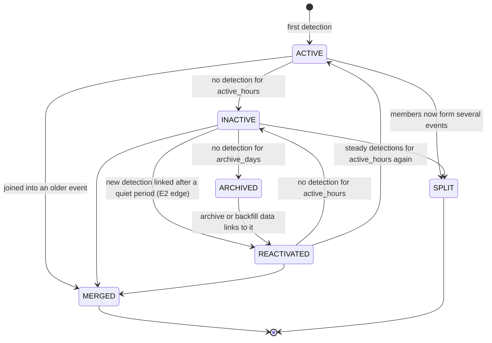

# Fire event model

**Status: implemented (events v3).** Algorithm: [CLUSTERING_ALGORITHM.md](CLUSTERING_ALGORITHM.md). Limitations: [CLUSTERING_LIMITATIONS.md](CLUSTERING_LIMITATIONS.md).
Audit: [FIRE_CLUSTERING_AUDIT.md](FIRE_CLUSTERING_AUDIT.md).

A FireLens *fire event* is **a group of satellite thermal detections that are contiguous in space
and time**. It is FireLens's best estimate that they come from one fire. It is not a fire
perimeter, and it says nothing certain about whether a fire has been extinguished.

## Identity

* **Canonical id** = `evt_` + hash of the event's earliest member detection, as today. It is
  deterministic, so incremental updates equal a full rebuild.
* An id is **never lost**. When it stops being canonical, `event_lineage` records why, and
  `GET /api/events/{old_id}` resolves to the current event (the response carries `resolved_from`).

| Change (detected by diffing member assignments) | Canonical id | Recorded |
|---|---|---|
| Event gained detections | unchanged | history version (`grown`) |
| Two or more events joined | the one with the earliest detection (deterministic) | `merged`: absorbed id → canonical, timestamp, ingest run |
| Event's members now form several events | the part holding the earliest member keeps the id; the others get their own deterministic ids | `split`: original → each part, with reason (`static_reclassified`, `archive_upgrade`, `rule_change`) |
| Earliest member changed (older data arrived, first pixel became a gas flare) | new | `renamed`: old → new |
| Every detection reclassified as non-fire (gas flare, volcano, platform) | none | `removed`, reason `static_reclassified` |

Alerts are deduplicated across lineage. A rule that alerted for an absorbed or renamed id does not
alert again for its successor.

## Lifecycle

`status` keeps its two API values (`active` / `inactive`) for compatibility. A new
`lifecycle_state` carries the full state:

* ACTIVE, INACTIVE, REACTIVATED and ARCHIVED are **computed from the detections and the current
  time**, so they are reproducible. REACTIVATED means the event's latest run of detections follows
  an internal gap longer than `active_hours`.
* MERGED and SPLIT are terminal states of an **id**, not of a live event. They exist only in
  `event_lineage` / `event_history`. The live table holds live events only, so no consumer has to
  filter them out.
* Wording: INACTIVE is shown as **"No detection in the last N h"**, never "extinguished" or
  "out". Satellites miss fires under cloud, smoke and canopy, and between passes (measured
  revisit gap p95 = 24 h).
* Every state change is written to `event_history` with timestamp, previous and new state, reason
  and ingest run, so it can be audited.

## Metrics per event

| Group | Field | Notes |
|---|---|---|
| Time | `start_at`, `end_at`, `observed_hours` | first and last detection; observed span, not fire duration |
| Detections | `detection_count`, `modis_count`, `viirs_count`, `count_by_satellite`, `pass_count` | a pass = one satellite overpass (satellite + minute) |
| Evidence | `evidence` | `single_detection` / `single_pass` / `multi_pass` |
| Intensity | `max_frp_mw` | maximum pixel FRP (unchanged) |
| | `mean_frp_viirs_mw`, `mean_frp_modis_mw` | per sensor, **never averaged together**: the sensors differ in resolution, detection limit and saturation |
| | `peak_pass_frp_mw` (+ sensor) | largest whole-fire FRP seen in one overpass (sum over that pass's pixels): an instantaneous fire power |
| | `intensity_trend` | `rising` / `falling` / `stable` / `insufficient_data`: latest pass vs median of the previous 3 passes **of the same sensor**; a change needs ×2 and ≥ 50 MW |
| | `total_frp_mw` | **deprecated**: kept for API compatibility and documented as a sum of instantaneous observations, not energy. The UI stops showing it. FRE (time-integrated energy) is not computed: polar-orbit sampling (2–8 passes per day) is too sparse to integrate without a diurnal model. |
| Place | `latitude`, `longitude` | FRP-weighted centre (unchanged) |
| | `west/south/east/north`, `extent_km` | bounding box and its largest side |
| Area: three distinct measures | `detection_hull_km2` | (1) area of the convex hull of detection centres: where detections occurred; 0 below 3 points |
| | `detected_footprint_km2` (= `area_km2`, kept as alias) | (2) union of nominal pixels: the estimated active-fire footprint at sensor resolution |
| | `burned_area_km2` | (3) **always null for now**: FireLens does not measure burned area |
| Evolution | `footprint_growth_km2_per_day`, `footprint_growth_se` | slope of the cumulative footprint per UTC day, least squares, with standard error; only with ≥ 3 distinct days and ≥ 2 passes on each, otherwise null. "Apparent growth of the detected footprint", not rate of spread |

Per-pass timeline: `event_passes` (event, satellite, sensor, time, pixel count, FRP sum, FRP max).
It is exposed by `GET /api/events/{id}/timeline` and can feed a chart in the detail panel.

## Storage (all additive)

| Table | Content |
|---|---|
| `fire_events` | live events. New columns for the metrics above. Existing columns unchanged. |
| `event_passes` | per-pass intensity timeline, rewritten only for affected events |
| `event_lineage` | `old_id, new_id, kind (merged/split/renamed/removed), reason, detections_moved, at` |
| `event_history` | `event_id, version, at, change (created/grown/updated/state/merged/split/renamed/removed), from_state, to_state, related_id, reason, snapshot (JSON)`, one row per actual change. Re-clustering that changes nothing tracked writes nothing. |
| `fire_events_legacy_v2` | one-time copy of the current events table before the migration rebuild |

Nothing is deleted. Detections are never modified by the event engine, apart from their `event_id`
assignment.

## API compatibility

* Every existing field and filter keeps its name and meaning (`area_km2` = detected footprint, as
  today).
* New fields and filters are added (`lifecycle_state`, `evidence`, `min_evidence`, area measures,
  per-sensor FRP).
* New endpoints: `GET /api/events/{id}/history`, `/timeline`, `/lineage`. An old id resolves to its
  canonical event instead of returning 404.
* Frontend changes are limited to wording:
  * "Total FRP" becomes "Peak pass FRP";
  * area is labelled "Detected footprint (not burned area)";
  * the status pill reads "No detection > N h".

  Optional: a small FRP-per-pass chart in the event panel.

## Known limitations

See [CLUSTERING_LIMITATIONS.md](CLUSTERING_LIMITATIONS.md).
